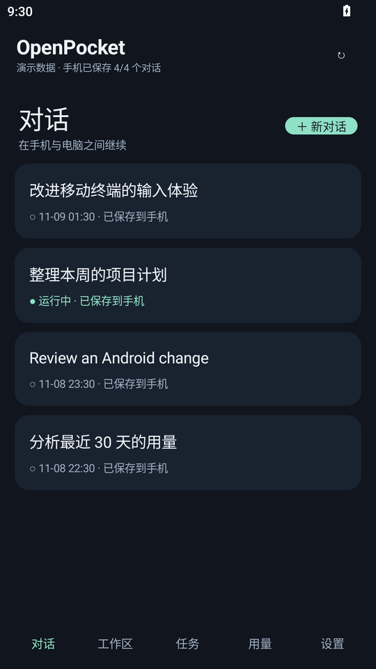
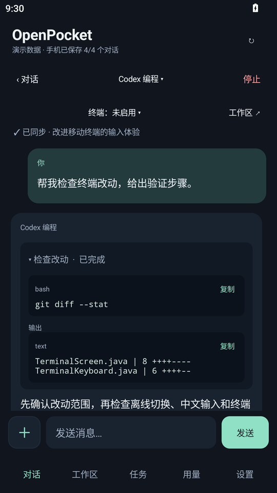
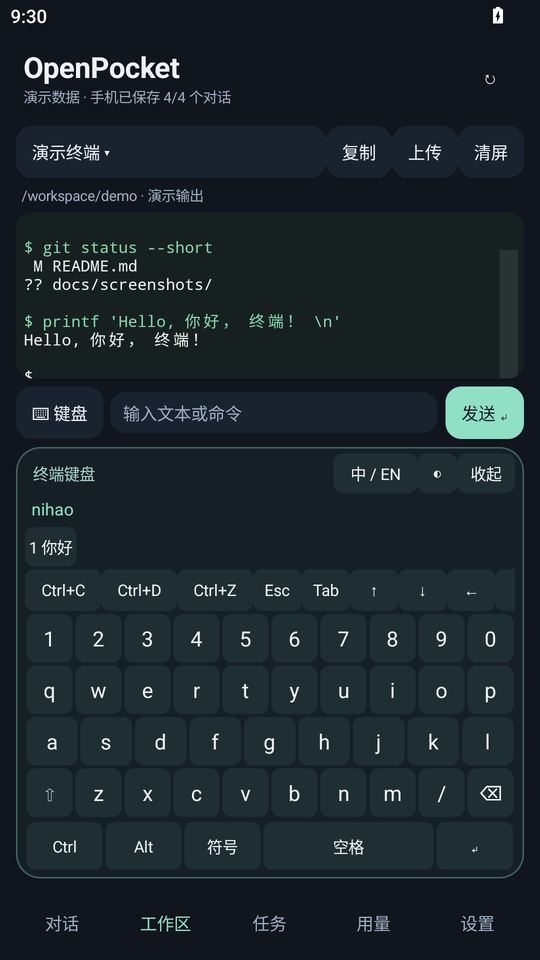
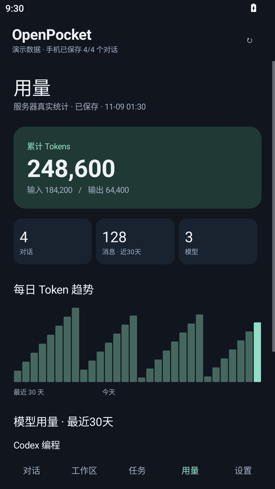

<div align="center">

# OpenPocket

**Your Open WebUI conversations, tasks, and terminal—in your pocket.**

Native Android client · Offline chat history · Interactive terminal · Offline Chinese keyboard

[简体中文](README.md) · **English** · [繁體中文](README.zh-TW.md) · [日本語](README.ja.md)

[](https://github.com/RangzhiWu/OpenPocket/actions/workflows/android.yml)
[](https://github.com/RangzhiWu/OpenPocket/releases)
[](https://github.com/RangzhiWu/OpenPocket/releases)
[](LICENSE)

[Download APK](https://github.com/RangzhiWu/OpenPocket/releases/latest) · [Server compatibility](docs/server-compatibility.md) · [Development](docs/development.md) · [Report an issue](https://github.com/RangzhiWu/OpenPocket/issues)

</div>

OpenPocket is for people who run their own Open WebUI server. Continue desktop conversations on your phone, inspect server tasks and tool output, read saved history offline, or open an interactive terminal.

> **Before connecting:** terminal access, background tasks, and usage statistics require matching server APIs. This repository contains the Android client and a few optional terminal helpers, not a complete Agent, Open WebUI, or OpenTerminal deployment. Different Open WebUI versions may lack some extensions. Read the [server requirements](docs/server-compatibility.md) first.

## Screenshots

These are actual app screens rendered in an isolated Android emulator. Conversations, terminal output, and statistics are **demo fixtures**, not private messages or measured usage. See [capture details](docs/screenshots/README.md).

<table>
  <tr>
    <td align="center"><strong>Conversations & offline history</strong><br></td>
    <td align="center"><strong>Chat & tool output</strong><br></td>
  </tr>
  <tr>
    <td align="center"><strong>Terminal & Chinese keyboard</strong><br></td>
    <td align="center"><strong>Usage & trends</strong><br></td>
  </tr>
</table>

These language versions translate the **README documentation**. The app interface is currently primarily Simplified Chinese. Linked development and server guides are currently written in Simplified Chinese.

## Features

| What you need | How OpenPocket handles it |
| --- | --- |
| Different models in different chats | Model selection is saved per conversation and restored when switching chats or reopening the app |
| History on an unreliable connection | Full messages, reasoning, and tool output are stored in SQLite, separated by account and server |
| Many conversations to sync | Missing conversations are saved first; unchanged conversations reuse their cached snapshots |
| A desktop task is still running | Inspect the server's task state and saved output; closing the app does not cancel the server task |
| Interactive server tools | Bundled xterm.js renders ANSI, colors, cursor movement, and alternate screens, with raw control-key input |
| Chinese text in a terminal | A docked offline pinyin keyboard includes Ctrl/Alt, Esc, Tab, and arrows; opening it raises the output area |
| Copying or reviewing logs | Copy the screen or scrollback as plain text; touch scrolling includes inertia |
| Usage without a long wait | Show persisted statistics first, reuse fresh results for one minute, and coalesce in-flight refreshes |
| Files and conversation organization | Upload files or images, see processing status, rename chats, and keep attachment references |

The terminal keyboard uses a fixed dictionary. It does not learn input history, predict the next sentence, or contact an online conversion service. Tool cards display existing server output; expanding or copying a card does not execute the command again.

## Install and get started

1. Download the signed APK from [Releases](https://github.com/RangzhiWu/OpenPocket/releases/latest). Requires **Android 8.0 / API 26 or newer**.
2. Enter your Open WebUI **root URL**, email, and password, for example `https://webui.example.com`. Do not append a page path such as `/chat`.
3. Open an existing conversation, or create one and select a model offered by your server.
4. Stay online until the conversations you want are marked as saved to the phone. Chats that have never been downloaded cannot be read offline.
5. For terminal access, configure the authenticated terminal proxy on your server and grant your account access, then select OpenTerminal in the app.

Public servers require HTTPS. HTTP is accepted for explicit trusted private-network or loopback addresses, including private VPN IPs; it is not itself encrypted. No server, account, or API key is bundled with the app.

Updates signed with the same certificate can retain app data. Keep your signing key if building your own version. Each release includes a signed APK, a ZIP exported from its source tag, and `SHA256SUMS`.

## Terminal controls

Tap the terminal or command field to open the docked keyboard. Hide it with its collapse button or Android Back. Terminal input does not open the system IME; regular chat input still uses the system keyboard.

| Control | Typical behavior |
| --- | --- |
| Ctrl+C | Interrupt the foreground program |
| Ctrl+D | Send EOF; usually exits a shell at an empty prompt |
| Ctrl+Z | Suspend the foreground job; use `fg` in the shell to resume |
| Esc, Tab, arrows | Menus, completion, and movement, depending on the current program |
| Ctrl / Alt | Compose control or modified terminal keys |
| 中 / EN, Space, numbered candidates | Switch offline pinyin mode and select Chinese text |
| Long press / Copy | Select or copy screen text or scrollback |
| Clear | Clear the local display without stopping the server program |

A genuine controlling PTY, Bash, and job control are required on the server. Installing this APK does not install Codex or Claude CLI, configure their credentials, or set up an API relay.

## Offline data, synchronization, and privacy

- Local reads, history downloads, and regular network requests run on separate queues. Saved chats can open while server requests time out.
- Each conversation has its own snapshot, not just the most recently opened chat. The UI shows overall and per-chat save status.
- When the server has no message-level incremental API, changed conversations are fetched as complete snapshots. Unchanged snapshots are reused.
- Normal usage statistics come from server records, with a one-minute cache. Missing historical usage is not estimated from text length; screenshot numbers are illustrative.
- Passwords are not persisted. Tokens are encrypted using Android Keystore, history is stored in app-private storage, and app backup is disabled.
- Closing the app retains the cache. Signing out removes the current account's local chat history and token, without deleting server records.

See [privacy](docs/privacy.md) and [security](SECURITY.md).

## FAQ

**Does it work with every Open WebUI installation?**

There is no comprehensive upstream-version compatibility matrix yet. Basic chat and extended terminal/task/usage APIs have different requirements. Verify your deployment with a test account first.

**Why is a conversation unavailable offline?**

Its initial download may not have finished. Check its save status while online. Attachment source files are not downloaded for offline use.

**Why not fetch usage every time I open the page?**

Persisted results appear first, and results less than a minute old are reused. The top refresh button can request an update. Server-side aggregation is controlled by your backend.

**Does the app have an English UI?**

This is an English README translation. The app itself is currently primarily Simplified Chinese.

**Does Ctrl+Z exit a CLI?**

It normally suspends the job. Use `fg` to resume, and follow the CLI's own exit controls to quit.

## Build from source

Requires **JDK 17, Android SDK 34, and Build Tools 35.0.0**. The Gradle Wrapper is included.

```bash
git clone https://github.com/RangzhiWu/OpenPocket.git
cd OpenPocket/android-client
# Configure JAVA_HOME and ANDROID_HOME, or sdk.dir in local.properties
./gradlew :app:assembleDebug :app:lintRelease
```

On Windows, use `gradlew.bat`. Configure release signing through environment variables; private keys are not in the repository. A normal build needs only the JDK and Android SDK. See the [development guide](docs/development.md) for signing and optional dictionary generation.

Core behavior is checked locally before release. GitHub CI runs the Android build, Lint, and public-file audit.

## Repository layout

```text
android-client/    Native Java Android app and Gradle configuration
server/terminal/   Optional Linux Bash / PTY helpers
scripts/           Dictionary generation and public-file audit
docs/              Server, development, privacy, releases, and screenshots
.github/           CI and contribution templates
README*.md         Project introductions in multiple languages
```

## Current limitations

- No background push notifications or voice input.
- Some Open WebUI versions lack the required task, usage, or terminal extensions.
- Attachment names and references are cached, but original files are not available offline.
- Changed chats use complete snapshots; server usage aggregation is not guaranteed to be incremental.
- Pinyin uses a fixed dictionary with limited rare-word coverage and candidate ranking.
- Full-screen CLI behavior depends on the device WebView, server PTY, and program. Not every combination has been tested.

## Contributing and license

Issues and pull requests are welcome. Read [CONTRIBUTING.md](CONTRIBUTING.md); report vulnerabilities according to [SECURITY.md](SECURITY.md). See [CHANGELOG.md](CHANGELOG.md) for releases.

Original code is licensed under [MIT](LICENSE). Third-party components keep their own licenses; see [THIRD_PARTY_NOTICES.md](THIRD_PARTY_NOTICES.md). OpenPocket is an independent client and is not affiliated with Open WebUI, OpenAI, or Anthropic.
