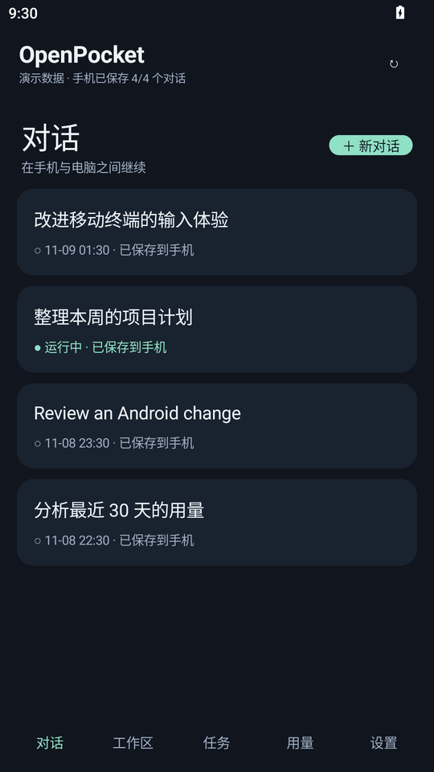
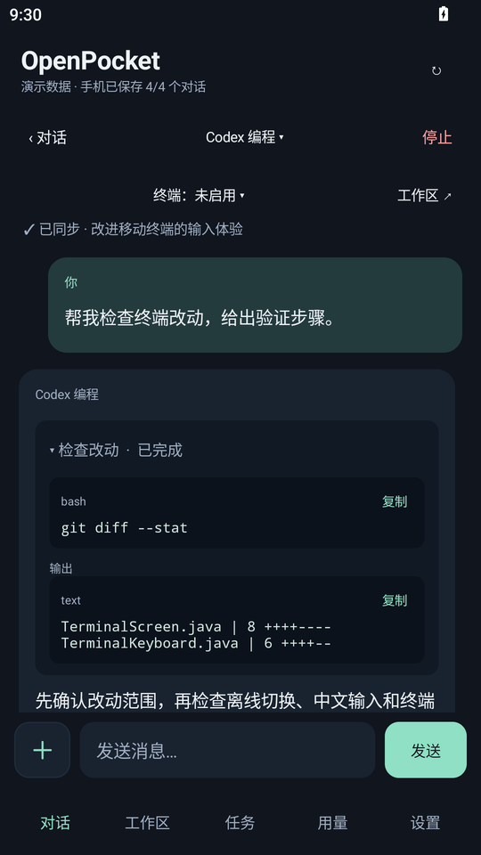
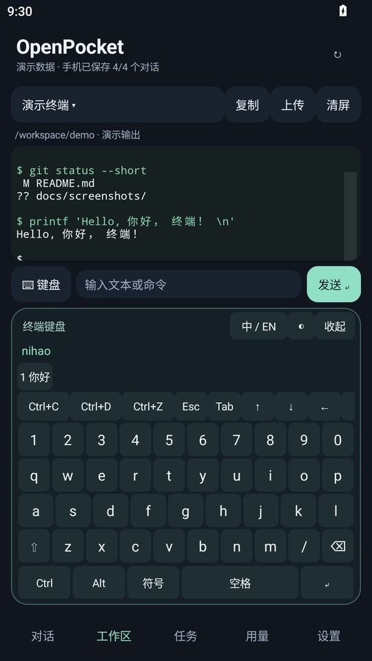
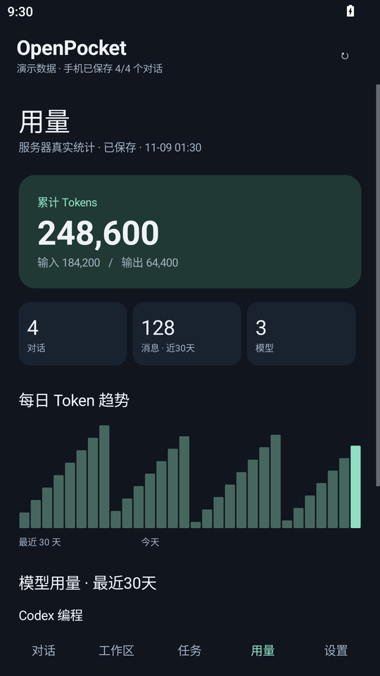

<div align="center">

# OpenPocket

**Open WebUI の会話、タスク、ターミナルをポケットに。**

ネイティブ Android クライアント · オフライン履歴 · 対話型ターミナル · オフライン中国語キーボード

[简体中文](README.md) · [English](README.en.md) · [繁體中文](README.zh-TW.md) · **日本語**

[](https://github.com/RangzhiWu/OpenPocket/actions/workflows/android.yml)
[](https://github.com/RangzhiWu/OpenPocket/releases)
[](https://github.com/RangzhiWu/OpenPocket/releases)
[](LICENSE)

[APK をダウンロード](https://github.com/RangzhiWu/OpenPocket/releases/latest) · [サーバー要件](docs/server-compatibility.md) · [開発ガイド](docs/development.md) · [Issue](https://github.com/RangzhiWu/OpenPocket/issues)

</div>

OpenPocket は、自分の Open WebUI サーバーを利用するための Android アプリです。PC の会話をスマートフォンで続けたり、サーバーのタスクやツール出力を確認したり、保存済みの履歴をオフラインで読んだり、対話型ターミナルを操作したりできます。

> **接続前に確認してください：** ターミナル、バックグラウンドタスク、使用量統計には対応するサーバー API が必要です。このリポジトリに含まれるのは Android クライアントと一部の補助スクリプトです。Agent、Open WebUI、OpenTerminal の完全なサーバー構成は含まれません。バージョンによって拡張 API がない場合があります。[互換性ガイド](docs/server-compatibility.md)を確認してください。

## スクリーンショット

隔離された Android エミュレーターで実際に描画したアプリ画面です。会話、コマンド出力、統計値はすべて**デモデータ**であり、実際のアカウントや個人の会話を使用していません。[撮影方法](docs/screenshots/README.md)。

<table>
  <tr>
    <td align="center"><strong>会話一覧とオフライン保存</strong><br></td>
    <td align="center"><strong>会話とツール出力</strong><br></td>
  </tr>
  <tr>
    <td align="center"><strong>ターミナルと中国語入力</strong><br></td>
    <td align="center"><strong>使用量と推移</strong><br></td>
  </tr>
</table>

各言語版は **README の翻訳**です。アプリの UI は現在、主に簡体字中国語です。リンク先の開発・サーバーガイドも現在は主に簡体字中国語で記述されています。

## 主な機能

| 利用場面 | OpenPocket の動作 |
| --- | --- |
| 会話ごとにモデルを使い分けたい | モデル選択を会話単位で保存し、切り替えや再起動後も復元 |
| 不安定な通信でも履歴を読みたい | メッセージ、思考過程、ツール出力を SQLite に保存し、サーバー・アカウントごとに分離 |
| 大量の履歴を同期したい | 未保存の会話を優先し、更新日時に応じて変更分の会話を取得 |
| PC で開始したタスクを確認したい | サーバーの状態と既存の実行結果を表示。アプリを閉じてもサーバータスクは継続 |
| サーバー上の CLI を操作したい | 同梱の xterm.js で ANSI、色、カーソル、代替画面を描画し、制御キーを送信 |
| ターミナルで中国語を入力したい | オフラインのピンインと Ctrl/Alt、Esc、Tab、矢印キーを統合した下部キーボード |
| ログをコピーしたい | 画面またはスクロールバックをプレーンテキストでコピーし、慣性スクロールで閲覧 |
| 使用量をすぐ確認したい | 保存済み統計を先に表示し、1 分間のキャッシュと実行中リクエストの統合を使用 |
| 添付ファイルや会話を整理したい | ファイル・画像のアップロード、処理状態の表示、会話名の変更、添付参照の保存 |

ターミナルの中国語入力には固定辞書を使用します。入力履歴の学習、次の文の予測、オンライン変換は行いません。ツールカードを開いたりコピーしたりしても、コマンドは再実行されません。

## インストールと初期設定

1. [Releases](https://github.com/RangzhiWu/OpenPocket/releases/latest) から署名済み APK をダウンロードします。**Android 8.0 / API 26 以降**が必要です。
2. 自分の Open WebUI の**ルート URL**、メールアドレス、パスワードを入力します。例：`https://webui.example.com`。`/chat` などのページパスは付けません。
3. 既存の会話を開くか、新しい会話を作成してサーバーのモデルを選択します。
4. オフラインで読みたい会話が端末に保存されるまでオンラインにしておきます。初回取得が未完了の会話はオフラインで読めません。
5. ターミナルを使う場合は、認証付きプロキシとアカウント権限をサーバー側で設定し、アプリで OpenTerminal を選択します。

公開サーバーには HTTPS を使用します。明示的な信頼できるプライベートネットワークやループバックの IP では HTTP を使用できますが、HTTP 自体は暗号化されません。アプリにはサーバー、アカウント、API キーを同梱していません。

同じ証明書で署名した更新版は、データを保持したまま上書きできます。自分でビルドする場合は署名鍵を維持してください。リリースには APK、タグから出力したソース ZIP、`SHA256SUMS` を添付しています。

## ターミナルの操作

ターミナルまたはコマンド欄をタップすると下部キーボードが開き、出力領域が上に移動します。収納ボタンまたは Android の戻る操作で閉じます。ターミナルはシステム IME を開きません。通常のチャット入力はシステムキーボードを使用します。

| キー / 操作 | 一般的な用途 |
| --- | --- |
| Ctrl+C | フォアグラウンドのプログラムを中断 |
| Ctrl+D | EOF を送信。空のプロンプトでは通常 shell を終了 |
| Ctrl+Z | ジョブを一時停止。shell で `fg` を入力すると再開 |
| Esc、Tab、矢印 | メニュー、補完、移動。実際の動作はプログラムによる |
| Ctrl / Alt | 制御キーや修飾キーを組み合わせて送信 |
| 中 / EN、Space、数字候補 | オフラインのピンイン切り替えと中国語候補の選択 |
| 長押し / コピー | 画面や履歴のテキストを選択・コピー |
| クリア | ローカルの表示を消去。サーバープログラムは停止しない |

サーバーには制御 PTY、Bash、ジョブ制御が必要です。APK をインストールしても Codex / Claude CLI、その認証情報、API リレーは自動設定されません。

## オフライン保存・同期・プライバシー

- ローカル読み込み、履歴取得、通常の通信は別キューで処理します。通信がタイムアウトしても、保存済み会話を開けます。
- 最後に開いた会話だけでなく、各会話を個別のスナップショットとして保存します。全体の保存数と各会話の状態を表示します。
- サーバーにメッセージ単位の差分 API がない場合、更新された会話は完全なスナップショットとして再取得します。変更のない会話はキャッシュを使います。
- 通常の使用量はサーバーの記録に基づき、キャッシュは原則 1 分間有効です。欠けた過去の使用量を文字数から推測しません。スクリーンショットの数値は例示です。
- パスワードは保存しません。トークンは Android Keystore で暗号化し、履歴はアプリ専用領域に保存します。アプリのバックアップは無効です。
- アプリを閉じてもキャッシュは残ります。ログアウトすると現在のアカウントの端末内履歴とトークンを削除し、サーバーの記録は残します。

[プライバシー](docs/privacy.md)と[セキュリティ](SECURITY.md)も参照してください。

## よくある質問

**どの Open WebUI でも動きますか？**

すべての上流バージョンを網羅した互換表はまだありません。基本の会話 API と、タスク・使用量・ターミナルの拡張 API は要件が異なります。テストアカウントで確認してください。

**オフラインで開けない会話があるのはなぜですか？**

最初のダウンロードが未完了の可能性があります。接続中に保存状態を確認してください。添付ファイルの原本は現在オフライン保存されません。

**使用量を開くたびに再取得しないのはなぜですか？**

待ち時間を減らすため、保存済み統計を先に表示し、1 分以内の結果を再利用します。上部の更新ボタンで取得できます。サーバー側の集計方式はバックエンド次第です。

**日本語 UI はありますか？**

このファイルは README の日本語訳です。アプリ自体の UI は現在、主に簡体字中国語です。

**Ctrl+Z は CLI の終了操作ですか？**

通常は一時停止です。`fg` で再開できます。終了するには、その CLI が提供する操作を使用してください。

## ソースからビルド

**JDK 17、Android SDK 34、Build Tools 35.0.0** が必要です。Gradle Wrapper を同梱しています。

```bash
git clone https://github.com/RangzhiWu/OpenPocket.git
cd OpenPocket/android-client
# JAVA_HOME と ANDROID_HOME、または local.properties の sdk.dir を設定
./gradlew :app:assembleDebug :app:lintRelease
```

Windows では `gradlew.bat` を使用します。リリース署名は環境変数で設定し、秘密鍵はリポジトリに含めません。通常のビルドに必要なのは JDK と Android SDK だけです。署名と辞書生成は[開発ガイド](docs/development.md)を参照してください。

リリース前に主要な動作をローカルで確認します。GitHub CI は Android ビルド、Lint、公開ファイル監査を実行します。

## ディレクトリ構成

```text
android-client/    Java Android アプリと Gradle 設定
server/terminal/   任意の Linux Bash / PTY 補助スクリプト
scripts/           辞書生成と公開ファイル監査
docs/              接続、開発、プライバシー、リリース、画面資料
.github/           CI とコントリビューション用テンプレート
README*.md         多言語のプロジェクト紹介
```

## 現在の制限

- バックグラウンドのプッシュ通知と音声入力には未対応です。
- Open WebUI のバージョンによって、必要な拡張機能がない場合があります。
- 添付は名前と参照を保存しますが、原本はオフライン保存しません。
- 更新された会話は完全なスナップショットを使い、使用量の集計も差分計算とは限りません。
- ピンインは固定辞書を使用し、珍しい語や候補の順序には制限があります。
- 全画面 CLI は端末の WebView、サーバーの PTY、プログラムに依存し、すべての組み合わせを検証しているわけではありません。

## 貢献とライセンス

Issue と Pull Request を歓迎します。[貢献ガイド](CONTRIBUTING.md)を確認し、脆弱性は [SECURITY.md](SECURITY.md) に従って報告してください。変更履歴は [CHANGELOG.md](CHANGELOG.md) にあります。

オリジナルコードは [MIT License](LICENSE) で公開しています。第三者のコンポーネントはそれぞれのライセンスに従います。[第三者のライセンス](THIRD_PARTY_NOTICES.md)を参照してください。OpenPocket は独立したクライアントであり、Open WebUI、OpenAI、Anthropic とは提携していません。
