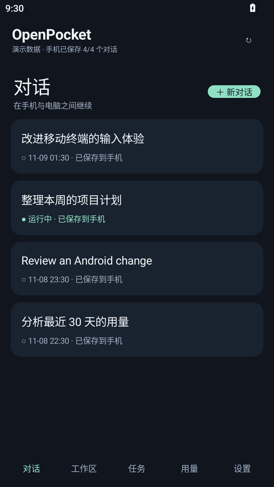
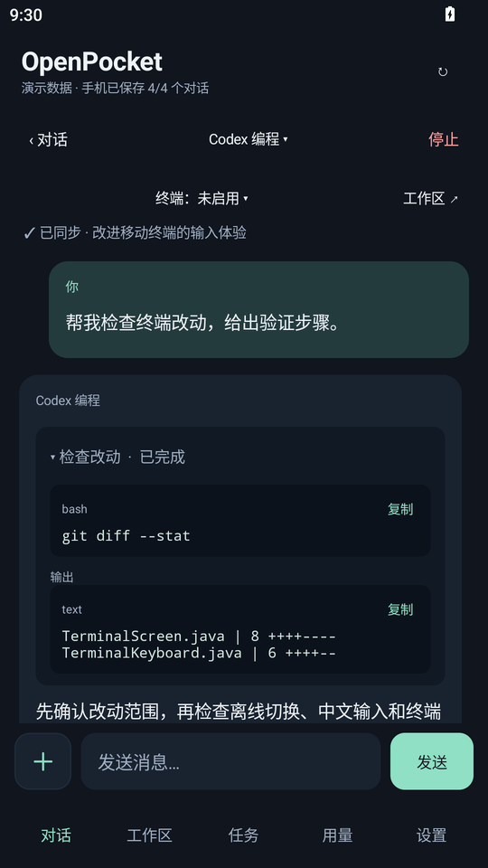
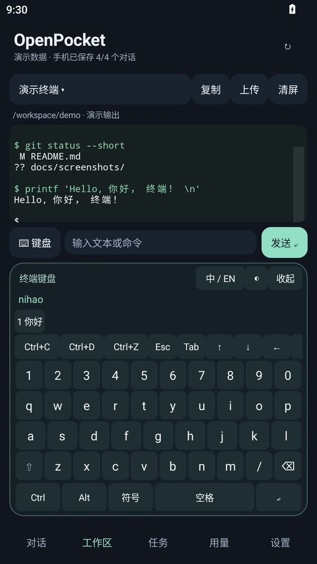
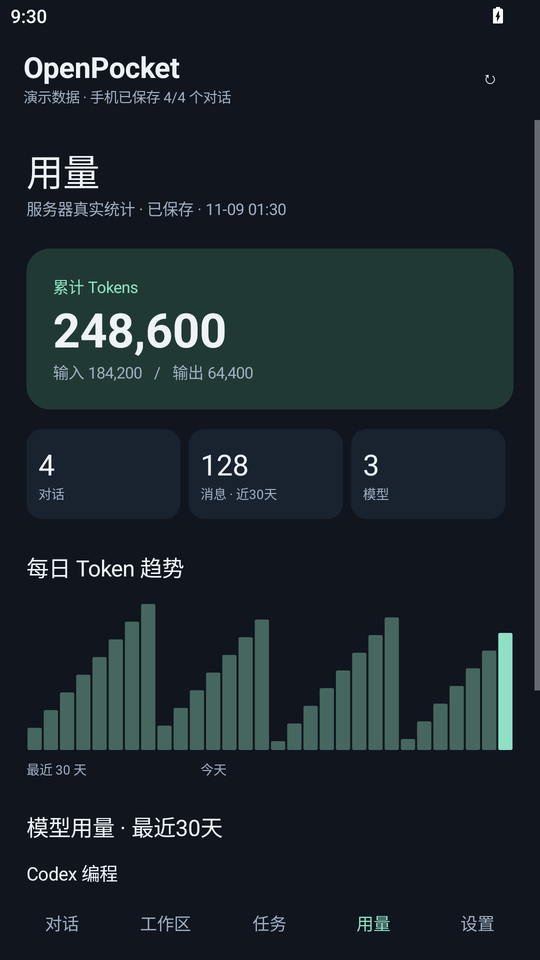

<div align="center">

# OpenPocket

**把 Open WebUI 的对话、任务与终端，装进口袋。**

原生 Android 客户端 · 多会话离线保存 · 交互终端 · 离线中文键盘

**简体中文** · [English](README.en.md) · [繁體中文](README.zh-TW.md) · [日本語](README.ja.md)

[](https://github.com/RangzhiWu/OpenPocket/actions/workflows/android.yml)
[](https://github.com/RangzhiWu/OpenPocket/releases)
[](https://github.com/RangzhiWu/OpenPocket/releases)
[](LICENSE)

[下载 APK](https://github.com/RangzhiWu/OpenPocket/releases/latest) · [服务器接入](docs/server-compatibility.md) · [开发指南](docs/development.md) · [问题反馈](https://github.com/RangzhiWu/OpenPocket/issues)

</div>

OpenPocket 面向拥有自己 Open WebUI 服务的用户：在手机上继续电脑端的对话，查看服务器任务与工具输出，离线翻阅已保存的历史，也能直接进入交互终端处理工作。

> **这是配合改造版 Open WebUI 使用的客户端。** OpenPocket 最初为维护者自行改造的 Open WebUI 部署开发，完整功能依赖该部署的 Agent 接入、任务与工具输出、用量记录和终端环境。安装 APK 不会给原版 Open WebUI 自动增加这些能力。目前公开的是客户端与少量终端辅助脚本，完整服务端改造源码和一键部署包尚未提供。请先阅读 [服务端改造与功能依赖](docs/backend-customizations.md) 和 [接口要求](docs/server-compatibility.md)。

## 与 Open WebUI 的关系

这个项目来自“先改造自己的 Open WebUI，再为它做手机端”的使用场景。手机连接 Open WebUI，由服务端接入模型或 Agent、执行任务、保存结果，并通过已认证的代理访问 OpenTerminal；手机负责显示、输入和本地保存。下面区分功能分别由谁提供，不能把客户端截图当成原版 Open WebUI 的兼容性承诺。

| 功能 | 手机端提供 | 服务端需要提供 |
| --- | --- | --- |
| 登录、模型与会话 | 原生页面、每会话模型选择、多会话离线缓存 | 兼容的认证、模型和会话接口；局部更新保留其他会话字段 |
| 任务助手 / Codex 等 Agent | 选择服务端公布的模型，查看状态、思考和工具卡片 | Agent 适配、后台任务、消息持久化与实时事件；不会随 APK 安装 |
| 工具执行结果 | 展开与复制已有输出 | 将执行过程、命令和结果保存为消息；维护者的部署做过工具事件与终端文本适配 |
| 用量统计 | 统计展示、本地持久化、一分钟请求缓存 | 从模型 / Agent 的真实 usage 记录并聚合；维护者的部署做过用量采集与历史修复 |
| 交互终端 | xterm.js、控制键、中文键盘、复制与滚动 | OpenTerminal 代理、控制 PTY、Bash、CLI 环境；当前尺寸同步还需要配套辅助脚本与权限 |

**连接原版 Open WebUI 时，请按接口逐项验证。** 基础接口也有版本差异，目前没有经过验证的原版版本清单。上述依赖不表示每项都必须修改上游代码；如果现有服务端已满足接口与行为要求，可直接复用。缺少后台或扩展接口时，相关功能无法完整使用，仅安装 APK 或复制 `server/terminal/` 都不能复现维护者的整套环境。

现有仓库可独立构建 Android 应用；如需从零复现完整服务，还需要准备兼容的后端。服务端已做过哪些改造、哪些未随仓库公开、部署检查顺序见 [详细说明](docs/backend-customizations.md)。

## 界面预览

以下是隔离 Android 模拟器中实际渲染的应用界面。会话、命令输出和统计数字均为演示数据，不包含真实账号或私人消息。[截图来源](docs/screenshots/README.md)。

<table>
  <tr>
    <td align="center"><strong>多会话与离线保存</strong><br></td>
    <td align="center"><strong>对话与工具输出</strong><br></td>
  </tr>
  <tr>
    <td align="center"><strong>终端与中文键盘</strong><br></td>
    <td align="center"><strong>用量与趋势</strong><br></td>
  </tr>
</table>

多语言版本是 **README 文档翻译**；应用界面目前以简体中文为主。

## 可以做什么

| 场景 | OpenPocket 的处理方式 |
| --- | --- |
| A 对话用任务助手，B 对话用编程模型 | 每个对话独立保存模型选择；切换页面、离线恢复与重开应用时保持各自配置 |
| 网络不稳定，也想查看历史 | 完整消息、思考过程与工具输出保存到手机 SQLite，按服务器和账号隔离 |
| 历史很多，担心每次重下 | 先保存缺失的会话，再按更新时间同步变化；未变化的会话复用缓存 |
| 电脑端任务还在运行 | 手机查看状态与已有执行过程；关闭客户端不会取消服务器上的任务 |
| 需要操作服务器上的 CLI | 使用本地打包的 xterm.js 显示 ANSI、颜色、光标和备用屏幕，输入原始控制键 |
| 在终端输入中文 | 底部键盘集成离线拼音、Ctrl/Alt、Esc、Tab 和方向键，展开时抬高输出区 |
| 想复制日志或回看输出 | 长按或点击复制，选择当前屏幕或含历史输出的文本；支持触摸与惯性滚动 |
| 想看用量，又不想反复等待 | 先显示持久化缓存，一分钟内复用结果，后台更新并合并在途请求 |
| 带文件继续对话 | 上传文件或图片，查看解析状态；支持会话改名与附件引用保存 |

终端中文输入采用固定词库，不学习输入历史、不预测下一句，也不联网转换。命令卡片只展示服务器已经执行的内容，不会因展开或复制而重新执行。

## 安装与开始使用

1. 从 [Releases](https://github.com/RangzhiWu/OpenPocket/releases/latest) 下载签名 APK，需要 **Android 8.0 / API 26 或更高版本**。
2. 打开应用，填写自己的 Open WebUI **根地址**、邮箱和密码，例如 `https://webui.example.com`。不要附加 `/chat` 等页面路径。
3. 登录后选择已有对话，或新建对话并选择服务器提供的模型。
4. 保持联网，等待需要离线阅读的会话显示“已保存到手机”；首次同步尚未完成的会话需要联网读取。
5. 使用终端前，先在自己的服务器配置终端代理，并为当前账号授权，再在应用中选择 OpenTerminal。

公网地址使用 HTTPS；可信局域网、回环或私人 VPN 的 IP 地址支持 HTTP。应用没有预置服务器、账号或 API Key。HTTP 本身不提供加密，网络接入与证书校验要求见 [服务器兼容说明](docs/server-compatibility.md)。

同签名版本可以覆盖安装并保留数据；自行签名的构建必须继续使用自己的原签名。发布页提供 APK、标签对应的源码 ZIP 和 `SHA256SUMS`。

## 终端怎么用

轻点终端或命令输入框展开底部键盘，点击“收起”或按系统返回键恢复输出区高度。终端页面不创建系统输入法连接；普通对话输入仍使用系统输入法。

| 按键 / 操作 | 常见用途 |
| --- | --- |
| Ctrl+C | 中断前台程序 |
| Ctrl+D | 发送 EOF；空 shell 提示符下通常退出 shell |
| Ctrl+Z | 暂停前台程序；在 shell 输入 `fg` 可恢复 |
| Esc、Tab、方向键 | 交互菜单、补全与移动，具体行为由当前程序决定 |
| Ctrl/Alt 修饰键 | 组合控制键，或发送终端程序需要的按键 |
| 中 / EN、空格、数字候选 | 切换离线拼音，选字并提交 |
| 长按 / 复制 | 选择并复制当前屏幕或带历史的纯文本 |
| 清屏 | 清理本地终端显示，不中断服务器程序 |

交互终端需要服务端提供真正的控制 PTY、Bash 与作业控制。Codex、Claude 等 CLI 是否安装、如何认证及是否使用中转，由服务器环境决定；安装 APK 不会自动完成这些配置。

## 离线、同步与隐私

- **先读本地，再同步网络。** 本地读取、历史下载和普通网络请求使用独立队列，服务器超时不会让已保存会话排队等待。
- **每个会话分别保存。** 不只是上次停留的那个会话；顶部显示整体保存数量，列表显示各自状态。
- **变化会话更新快照。** 服务端没有消息级增量接口时，变化的对话仍重新获取完整快照，不声称消息级增量同步。
- **用量使用真实记录。** 正常运行读取服务器统计，缓存默认一分钟有效；缺失的历史用量不按字数估算。截图里的数字仅是演示。
- **凭据留在自己的环境。** 登录密码不落盘，令牌经 Android Keystore 加密，历史保存在应用私有目录，禁用应用备份。
- **退出与登出不同。** 关闭应用保留缓存；主动退出登录删除当前账号的手机历史与令牌，不删除服务器记录。

详见 [数据与隐私](docs/privacy.md) 和 [安全说明](SECURITY.md)。

## 常见问题

**装好就能直接连接任意 Open WebUI 吗？**

不保证。本项目基于维护者改造后的 Open WebUI 部署开发，完整服务端改造尚未随仓库公开。原版是否可用，需要分别核对基础会话接口与扩展功能；目前没有经过验证的原版版本清单。先阅读 [改造说明](docs/backend-customizations.md) 并用测试账号核对 [接口要求](docs/server-compatibility.md)。

**为什么有些会话离线时还看不到？**

该会话可能尚未完成首次保存。联网后查看保存数量与单个会话状态；附件原文件目前不会下载成离线副本。

**为什么统计不是每次打开都立即重新查询？**

应用优先显示上次保存的统计，并复用一分钟内的结果，减少等待和重复请求。顶部刷新可主动更新；服务端聚合方式由服务端实现决定。

**文档有几种语言，应用也能切换语言吗？**

目前提供简体中文、英文、繁体中文与日文 README，应用界面暂以简体中文为主。

**终端里的 Ctrl+Z 算退出吗？**

通常是暂停作业，不是结束。需要恢复时在 shell 输入 `fg`；退出方式以当前 CLI 自己的交互规则为准。

## 从源码构建

需要 **JDK 17、Android SDK 34、Build Tools 35.0.0**，仓库自带 Gradle Wrapper。

```bash
git clone https://github.com/RangzhiWu/OpenPocket.git
cd OpenPocket/android-client
# 配置 JAVA_HOME、ANDROID_HOME，或通过 local.properties 设置 sdk.dir
./gradlew :app:assembleDebug :app:lintRelease
```

Windows 使用 `gradlew.bat`。正式签名通过环境变量配置，私钥不包含在仓库中。普通构建只需要 JDK 与 Android SDK。词库重建与签名步骤见 [开发指南](docs/development.md)。

发布前在本地验证核心功能。GitHub CI 执行 Android 构建、Lint 和公开文件检查。

## 项目结构

```text
android-client/    原生 Java Android 应用与 Gradle 配置
server/terminal/   可选 Linux Bash / PTY 辅助脚本
scripts/           拼音词库生成与公开文件检查
docs/              接入、开发、隐私、发布和截图说明
.github/           CI、Issue 与 Pull Request 模板
README*.md         多语言项目介绍
```

## 当前限制

- 无后台推送和语音输入；前台同步与重开应用后的恢复依赖服务器可用性。
- 完整功能依赖配套的 Open WebUI 服务端；完整改造源码与一键部署包尚未公开，原版版本兼容性未逐一验证。
- 附件只保存名称与引用，原文件暂不离线下载。
- 变化会话使用完整快照；服务端用量聚合不保证增量计数。
- 拼音采用固定词库，复杂长句可分词输入，生僻词覆盖与候选排序有限。
- 全屏 CLI 的显示与操作还取决于设备 WebView、服务端 PTY 和具体程序，尚未验证全部组合。

## 参与与许可

欢迎提交 [Issue](https://github.com/RangzhiWu/OpenPocket/issues) 和 Pull Request。贡献前请阅读 [贡献指南](CONTRIBUTING.md)，安全问题按 [SECURITY.md](SECURITY.md) 报告。版本记录见 [CHANGELOG.md](CHANGELOG.md)。

使用代码 Agent 维护项目时，先阅读根目录 [AGENTS.md](AGENTS.md)，其中记录项目背景、代码结构、功能约束与公开发布边界。

原创代码使用 [MIT License](LICENSE)，第三方组件保留各自许可，见 [第三方声明](THIRD_PARTY_NOTICES.md)。OpenPocket 是独立客户端项目，与 Open WebUI、OpenAI 或 Anthropic 无隶属关系。
