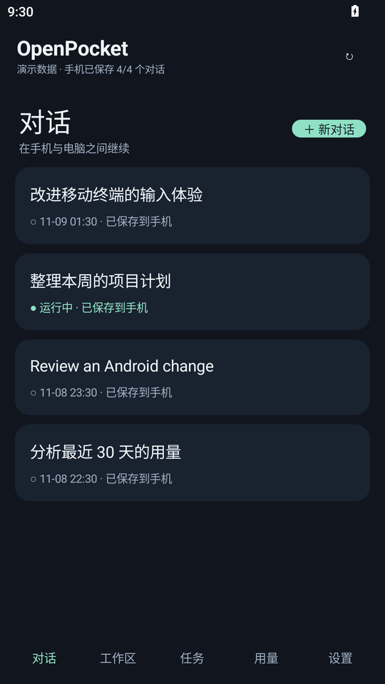
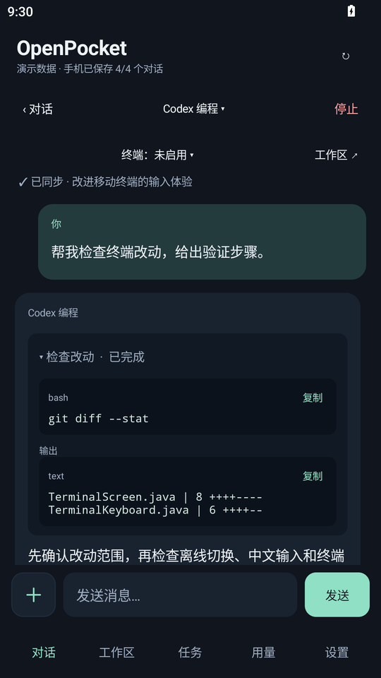
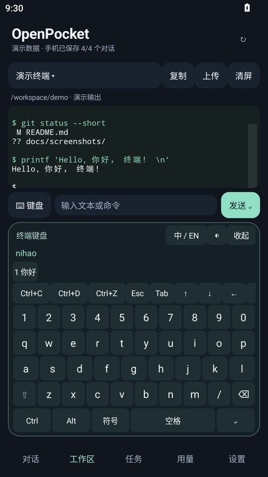
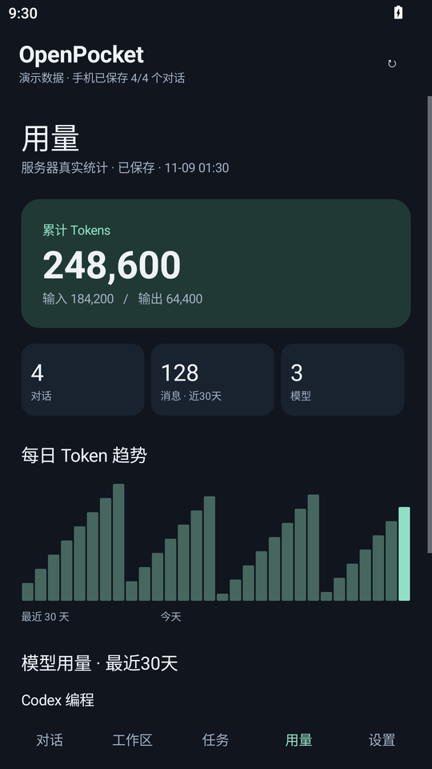

<div align="center">

# OpenPocket

**把 Open WebUI 的對話、任務與終端，裝進口袋。**

原生 Android 用戶端 · 多對話離線保存 · 互動終端 · 離線中文鍵盤

[简体中文](README.md) · [English](README.en.md) · **繁體中文** · [日本語](README.ja.md)

[](https://github.com/RangzhiWu/OpenPocket/actions/workflows/android.yml)
[](https://github.com/RangzhiWu/OpenPocket/releases)
[](https://github.com/RangzhiWu/OpenPocket/releases)
[](LICENSE)

[下載 APK](https://github.com/RangzhiWu/OpenPocket/releases/latest) · [伺服器相容性](docs/server-compatibility.md) · [開發指南](docs/development.md) · [問題回報](https://github.com/RangzhiWu/OpenPocket/issues)

</div>

OpenPocket 適合擁有自己 Open WebUI 服務的使用者：在手機延續電腦端的對話、查看伺服器任務及工具輸出、離線閱讀已保存的歷史，也能進入互動終端處理工作。

> **連線前請閱讀：** 終端、背景任務與用量統計需要對應的伺服器 API。本儲存庫提供 Android 用戶端及少量可選的終端輔助指令碼，不包含完整 Agent、Open WebUI 或 OpenTerminal 部署。不同版本可能缺少部分擴充功能，請先閱讀 [相容性說明](docs/server-compatibility.md)。

## 畫面預覽

以下為隔離 Android 模擬器中實際繪製的應用程式畫面。對話、命令輸出與統計數字都是**示範資料**，不包含真實帳號或私人訊息。詳見 [截圖來源](docs/screenshots/README.md)。

<table>
  <tr>
    <td align="center"><strong>多對話與離線保存</strong><br></td>
    <td align="center"><strong>對話與工具輸出</strong><br></td>
  </tr>
  <tr>
    <td align="center"><strong>終端與中文鍵盤</strong><br></td>
    <td align="center"><strong>用量與趨勢</strong><br></td>
  </tr>
</table>

多語言版本為 **README 文件翻譯**；應用程式介面目前以簡體中文為主。其他開發與接入文件目前也主要使用簡體中文。

## 主要功能

| 使用情境 | OpenPocket 的處理方式 |
| --- | --- |
| 不同對話使用不同模型 | 各自保存模型選擇，切換對話、離線恢復及重新開啟時不互相覆蓋 |
| 網路不穩也想閱讀歷史 | 完整訊息、思考過程及工具輸出保存在手機 SQLite，依帳號與伺服器隔離 |
| 有很多歷史對話 | 優先保存尚未下載的對話，再依更新時間同步變更，未變更的內容沿用快取 |
| 電腦端任務仍在執行 | 查看伺服器任務狀態與既有輸出，關閉用戶端不會取消伺服器任務 |
| 操作伺服器 CLI | 內附 xterm.js，支援 ANSI、色彩、游標、替代畫面與原始控制鍵 |
| 終端輸入中文 | 底部離線拼音鍵盤整合 Ctrl/Alt、Esc、Tab 與方向鍵，展開時抬高輸出區 |
| 複製或回看日誌 | 複製目前畫面或含歷史輸出的純文字，支援觸控與慣性捲動 |
| 快速查看用量 | 先顯示持久化快取，一分鐘內重用結果，背景更新並合併進行中的請求 |
| 附件與對話整理 | 上傳檔案或圖片、查看處理狀態、重新命名對話並保存附件參照 |

終端鍵盤使用固定字典，不學習輸入歷史、不預測下一句，也不連線轉換。命令卡片僅呈現伺服器已執行的內容，展開或複製不會重新執行命令。

## 安裝與開始使用

1. 從 [Releases](https://github.com/RangzhiWu/OpenPocket/releases/latest) 下載簽署的 APK，需要 **Android 8.0 / API 26 或以上版本**。
2. 輸入自己的 Open WebUI **根網址**、電子郵件與密碼，例如 `https://webui.example.com`，不要附上 `/chat` 等頁面路徑。
3. 開啟既有對話，或建立新對話並選擇伺服器提供的模型。
4. 保持連線，等待需要離線閱讀的對話顯示已保存至手機；首次下載未完成的對話仍需連線。
5. 終端功能需要先在伺服器設定已驗證身分的終端代理及帳號權限，再於應用程式選擇 OpenTerminal。

公開伺服器使用 HTTPS；明確指定的可信私人網路或回環 IP 可用 HTTP，包含私人 VPN IP。HTTP 本身不加密。應用程式沒有預設伺服器、帳號或 API Key。

相同簽章的版本可覆蓋安裝並保留資料；自行建置請持續使用原本的簽署金鑰。發行頁提供簽署 APK、對應標籤的原始碼 ZIP 及 `SHA256SUMS`。

## 終端操作

輕點終端或命令欄位以展開底部鍵盤，點選收起或按 Android 返回鍵恢復輸出區高度。終端不建立系統輸入法連線；一般對話仍使用系統鍵盤。

| 按鍵 / 操作 | 常見用途 |
| --- | --- |
| Ctrl+C | 中斷前景程式 |
| Ctrl+D | 傳送 EOF；空 shell 提示字元下通常會離開 shell |
| Ctrl+Z | 暫停前景工作，在 shell 輸入 `fg` 恢復 |
| Esc、Tab、方向鍵 | 選單、補齊與移動，實際行為由程式決定 |
| Ctrl / Alt | 組合控制鍵或修飾鍵 |
| 中 / EN、空白鍵、數字候選 | 切換離線拼音及選字 |
| 長按 / 複製 | 選取、複製目前畫面或歷史純文字 |
| 清除畫面 | 清理本機顯示，不中斷伺服器程式 |

伺服器需要真正的控制 PTY、Bash 與工作控制。安裝 APK 不會自動安裝 Codex / Claude CLI、設定憑證或 API 中繼服務。

## 離線、同步與隱私

- 本機讀取、歷史下載及一般網路請求使用獨立佇列，伺服器逾時不會阻塞已保存的對話。
- 每個對話都有自己的快照，並非只保存最後開啟的那個；介面會顯示整體數量及個別狀態。
- 伺服器沒有訊息層級的增量介面時，有變更的對話仍以完整快照更新；未變更的快照沿用快取。
- 正常用量來自伺服器記錄，快取預設一分鐘有效，缺少的歷史不會按字數估算。截圖數字僅供示範。
- 密碼不落盤，令牌使用 Android Keystore 加密；歷史存於應用程式私有目錄，停用系統備份。
- 關閉應用程式保留快取；主動登出會刪除目前帳號的手機歷史與令牌，不刪除伺服器記錄。

詳見 [資料與隱私](docs/privacy.md) 及 [安全說明](SECURITY.md)。

## 常見問題

**支援所有 Open WebUI 部署嗎？**

尚無涵蓋各上游版本的相容性矩陣。基本對話與終端、任務、用量擴充需求不同，請先以測試帳號核對接口。

**為什麼某些對話離線看不到？**

首次下載可能尚未完成，連線後請查看保存狀態。附件原始檔目前不會離線下載。

**為什麼用量不是每次開啟都重新查詢？**

為減少等待，先顯示既有統計並重用一分鐘內的結果。頂端重新整理按鈕可主動更新，伺服器端如何彙總由後端決定。

**有繁體中文介面嗎？**

這是 README 的繁體中文翻譯，應用程式介面目前以簡體中文為主。

**Ctrl+Z 會結束 CLI 嗎？**

通常只會暫停。使用 `fg` 恢復，並依目前 CLI 提供的操作離開程式。

## 從原始碼建置

需要 **JDK 17、Android SDK 34、Build Tools 35.0.0**，儲存庫已附 Gradle Wrapper。

```bash
git clone https://github.com/RangzhiWu/OpenPocket.git
cd OpenPocket/android-client
# 設定 JAVA_HOME、ANDROID_HOME，或在 local.properties 設定 sdk.dir
./gradlew :app:assembleDebug :app:lintRelease
```

Windows 使用 `gradlew.bat`，正式簽署透過環境變數設定，私密金鑰不在儲存庫中。一般建置僅需 JDK 與 Android SDK。字典重建與簽署步驟見 [開發指南](docs/development.md)。

發行前於本機驗證核心功能。GitHub CI 執行 Android 建置、Lint 與公開檔案檢查。

## 專案結構

```text
android-client/    原生 Java Android 應用程式與 Gradle 設定
server/terminal/   可選的 Linux Bash / PTY 輔助指令碼
scripts/           拼音字典產生及公開檔案檢查
docs/              接入、開發、隱私、發行及截圖說明
.github/           CI 與貢獻範本
README*.md         多語言專案介紹
```

## 目前限制

- 尚無背景推播通知與語音輸入。
- 不同 Open WebUI 版本可能缺少任務、用量或終端擴充功能。
- 附件僅保存名稱及參照，不下載原始檔供離線使用。
- 有變更的對話使用完整快照，用量彙總不保證增量計算。
- 拼音採用固定字典，罕見詞與候選排序有限。
- 全螢幕 CLI 還受裝置 WebView、伺服器 PTY 及程式影響，尚未驗證所有組合。

## 參與與授權

歡迎提交 Issue 與 Pull Request。請閱讀 [貢獻指南](CONTRIBUTING.md)，安全問題依 [SECURITY.md](SECURITY.md) 回報，版本記錄見 [CHANGELOG.md](CHANGELOG.md)。

原創程式碼採 [MIT License](LICENSE)，第三方元件保留各自授權，詳見 [第三方聲明](THIRD_PARTY_NOTICES.md)。OpenPocket 為獨立用戶端，與 Open WebUI、OpenAI 或 Anthropic 無隸屬關係。
