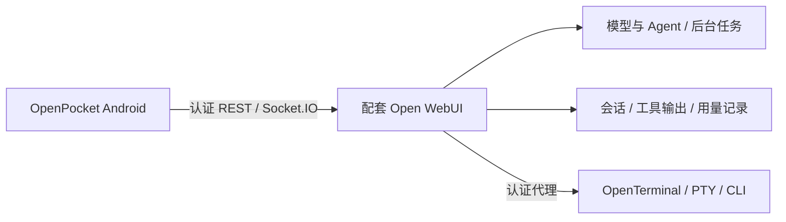

# 服务端改造与功能依赖

OpenPocket 来自维护者的自用项目：先改造自己的 Open WebUI，接入任务助手、编程 Agent、工具输出、用量记录和 OpenTerminal，再为这套环境开发原生 Android 客户端。因此，应用展示的完整能力由**手机端与配套服务端共同实现**，不能理解为给任意原版 Open WebUI 安装一个 APK 就能全部获得。

本文说明已有部署的功能分工和接入要求。当前没有发布完整服务端 Fork、对应上游版本的可应用补丁集或一键部署包，因而本文不是完整的服务端安装教程，也不承诺可仅凭本仓库从零复现所有服务。

## 请求经过哪些组件

手机不直接保存 OpenTerminal 管理密钥，不在本机运行 Codex / Claude，也不直接实现服务器任务调度。关闭手机应用后任务能否继续，取决于服务端的后台执行与持久化行为。

## 已有部署做过哪些配套工作

以下按已经使用过的功能描述，不将所有接口都认定为上游没有的功能，也不将私人环境的部署脚本作为通用补丁发布。

| 配套工作 | 服务端的职责与已有适配 | 客户端依赖 |
| --- | --- | --- |
| Agent 接入 | 将任务助手、编程 Agent 等接入服务端模型与执行流程；安装和认证相应运行时 | `/api/models` 中可选的模型及 `/api/chat/completions` 的会话语义。`server-codex-agent` 是应用优先选择的模型标识，不是所有部署都必需存在的内置模型 |
| 后台任务与实时消息 | 执行任务、持久化状态和消息、支持停止请求及实时事件 | `chat_id`、`session_id`、消息父子关系、Socket.IO `events` 和停止接口。断开手机连接后不能依赖手机继续转发生成结果 |
| 工具与命令输出 | 对 Agent 工具事件、执行状态和终端文本做适配，把命令与结果保存到会话供再次读取；已有部署做过历史输出恢复 | 工具卡片展示读取已保存的结果，展开与复制不应触发重新执行；不能只把结果发送到桌面浏览器内存 |
| 真实用量采集 | 修复网关响应的 usage 采集，兼顾流式与非流式响应；对能够找到真实记录的部分历史消息做恢复 | `/api/v1/users/usage?days=30` 提供聚合结果，消息可包含 `usage`。没有真实记录的历史不按字数估算 |
| OpenTerminal 接入 | 由 Open WebUI 提供带账号认证的代理与访问权限，连接服务端终端、文件和进程接口 | `/api/v1/terminals/` 以及其下的文件、执行、状态、输入和停止接口 |
| Shell 与 CLI 环境 | 配置交互 Bash、控制 PTY、PATH 和适合各 CLI 的运行时；已有部署做过普通账号与切换用户后的环境修复 | 能找到已安装的 CLI；控制字符、作业控制、光标和备用屏幕正常工作。CLI 认证、中转与网络可达性独立配置 |
| 提示符与终端尺寸 | 配套脚本维护 shell 标记，处理提示符的非打印序列，定位原 PTY 并调整尺寸 | `server/terminal/` 的脚本、交互 Bash 初始化与受限的尺寸同步权限；否则不能假定全屏 CLI 的布局与退出恢复正常 |

这些是现有部署的功能性说明，不是可应用的版本差异文件。尚未公布完整 Fork 地址、上游基线与提交对应表；不能根据接口路径推断任意原版版本已经验证通过。

## 哪些优化在手机端就已实现

- 每个对话分别保存模型选择，防止切换对话时共用选择；同步到服务器仍要求按会话更新且保留其他字段。
- SQLite 保存多个会话的完整快照，按服务器与账号隔离；本地读取和网络同步使用独立队列。
- 根据会话更新时间复用未变化的缓存；变化会话仍获取完整快照，不是消息级增量协议。
- 用量优先展示持久化缓存，一分钟内复用，并合并进行中的请求。**这不代表服务端的聚合已改成增量计数，也不保证服务端不会全量扫描。**
- xterm.js 渲染、细光标、文本复制、触摸滚动，以及底部控制键和离线中文键盘。

以上界面和缓存优化无需把手机端代码并入 Open WebUI；它们仍以服务器返回兼容数据为前提。

## 当前公开了什么

| 内容 | 当前仓库状态 |
| --- | --- |
| Android 应用、离线存储、终端渲染与键盘 | 包含源码与独立构建配置 |
| Bash 标记与 PTY 尺寸辅助脚本 | 包含在 `server/terminal/`；需要部署者配置路径、初始化和权限 |
| 客户端调用接口与约定 | 见 [服务器兼容说明](server-compatibility.md) 与对应 Java 源码 |
| 完整 Open WebUI 改造、Agent 网关、用量聚合实现 | 尚未作为可部署的完整源码或补丁集提供 |
| 完整 OpenTerminal 服务、CLI 安装和认证 | 需要部署者另外准备 |
| 私人部署脚本、账号、密钥、数据库与历史会话 | 不随公开仓库和发布包分发 |

`server/terminal/` 是辅助组件，不是整个后端。公开项目的 MIT 许可不能代替 Open WebUI、OpenTerminal 或其他独立服务自身的许可；使用、修改或再分发这些组件时，应分别核对其许可。

## 接入自己的服务器

1. **先确认基础接口。** 准备自己的 Open WebUI，核对认证、模型列表、会话列表与详情的请求和响应。公开仓库尚无经过验证的原版版本清单，不指定“装某个原版版本即可全部使用”。
2. **确认会话读写语义。** 模型或标题的局部更新必须只影响目标会话，并保留消息、历史和其他字段；更新时间需要随相关变更更新，供手机同步判断。
3. **需要 Agent / 任务时补齐执行层。** 服务端负责 Agent 运行时、凭据、后台执行、状态、停止请求及结果持久化；注册后才会出现在手机的模型列表。只接通普通模型 API 不等于拥有完整任务助手。
4. **需要用量时补齐真实记录与聚合。** 核对真实 usage 的采集和当前账号权限；返回客户端要求的 `totals`、`heatmap`、`top_models`。具体读取字段以 `MainActivity.java` 为准；不要把手机缓存优化当成服务器查询性能优化。
5. **需要终端时接好代理和 PTY。** 在服务器安装 OpenTerminal 和所需 CLI，配置账号权限、运行时、PATH 与认证；按 [交互终端要求](server-compatibility.md#交互终端) 配置辅助脚本和受限权限。不能用普通按行执行接口替代控制 PTY，也不要求给所有任务授予 root 权限。
6. **逐项验证后再使用真实数据。** 用隔离账号验证两段会话的模型互不影响、重开后历史可读、离线缓存、任务续跑与停止、终端全屏程序退出恢复、用量响应与已知记录一致。没有的服务端能力应视为未接入，不能靠 APK 安装补齐。

如要报告不兼容，请提供 OpenPocket 版本、服务端版本或提交、相关接口路径、状态码与去除隐私的响应结构。不要附账号令牌、真实消息或私人部署记录。
